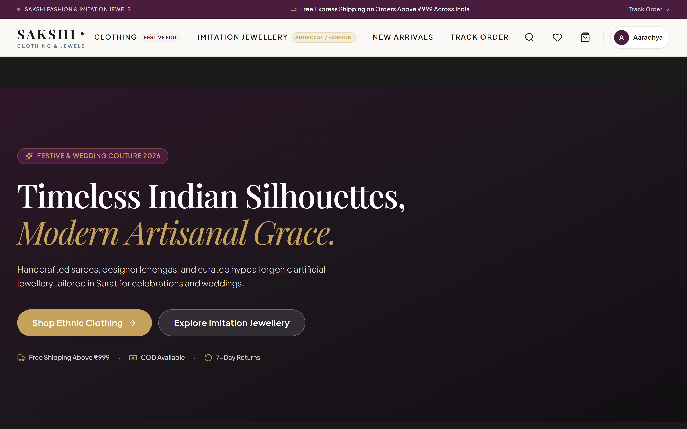
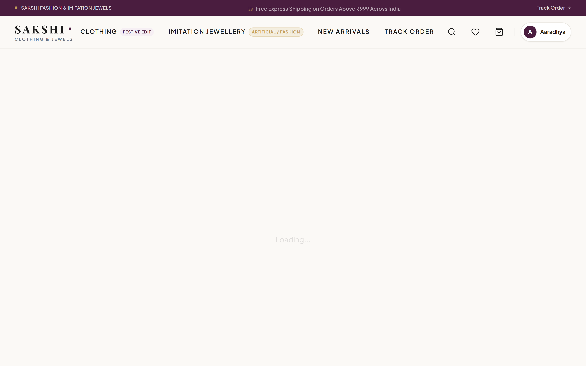
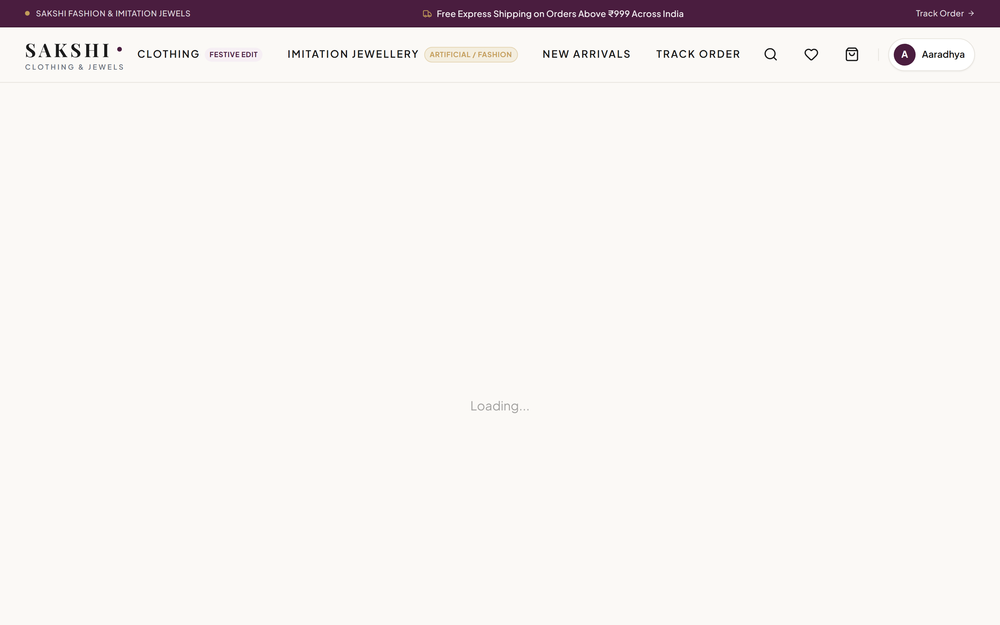

# Sakshi Clothing Atelier & Jewellery Storefront

[](https://nodejs.org)
[](https://react.dev)
[](https://vitejs.dev)
[](https://tailwindcss.com)
[](https://expressjs.com)
[](https://mongodb.com)
[](https://capacitorjs.com)
[](#license)

Production-grade e-commerce platform for **Sakshi Clothing** (Surat, Gujarat, India), featuring regional fashion apparel and an imitation jewellery collection. Built on an enterprise decoupled architecture: a high-fashion editorial customer storefront, an operational admin management dashboard, an installable Android Capacitor mobile package, and a hardened Express/MongoDB REST API.

---

## Table of Contents
1. [Architecture & Philosophy](#architecture--philosophy)
2. [Interface Previews](#interface-previews)
3. [Implemented Features](#implemented-features)
4. [Technology Stack](#technology-stack)
5. [Directory Layout](#directory-layout)
6. [Payment Architecture & Flow](#payment-architecture--flow)
7. [Getting Started (Local Development)](#getting-started-local-development)
8. [Environment Configuration](#environment-configuration)
9. [Testing & Quality Assurance](#testing--quality-assurance)
10. [Operational Scripts & Maintenance](#operational-scripts--maintenance)
11. [Deployment Architecture](#deployment-architecture)
12. [Security & Compliance](#security--compliance)
13. [Roadmap](#roadmap)
14. [License](#license)

---

## Architecture & Philosophy

The platform operates on the **Authoritative Server Single-Source-of-Truth** principle:
- **Zero Client Calculation Trust:** Cart subtotals, variant discounts, tiered free delivery, and payment gateway payloads are strictly computed on the backend (`POST /api/v1/cart/quote`). The client UI never calculates or mutates payable amounts.
- **Strict Indian E-Commerce Compliance:** Features genuine GSTIN displays, tax-inclusive INR pricing, courier OTP tracking, statutory Grievance Officer disclosures, and a clear 48-hour damaged/defective claim guarantee.
- **Fail-Safe Inventory Locking:** 30-minute stock reservation during checkout initiation with an automated background worker (`stockCleanupJob.js`) that safely restores inventory on abandoned sessions.

---

## Interface Previews

| Desktop Editorial Storefront | Mobile Commerce Experience |
|:---:|:---:|
|  |  |
| *Full-bleed editorial canvas with GSAP & Motion animations* | *Bottom-bar navigation, gesture-friendly mobile drawer* |

| Authoritative Cart & Delivery Bar | Instant UPI Checkout |
|:---:|:---:|
|  |  |
| *Real-time free shipping threshold calculator (>= ₹300)* | *Direct UPI integration with automated signature verification* |

*Additional UI walkthroughs and visual inspection assets are preserved in [docs/screenshots/](docs/screenshots/) and [docs/recordings/](docs/recordings/).*

---

## Implemented Features

### 🛍️ Customer Storefront (`frontend/customer`)
- **Editorial Design System:** High-end typography (`Playfair Display`, `Outfit`), warm ivory base (`#FBF9F6`), plum accents (`#4A1D3F`), champagne gold highlights (`#C6A15B`), and smooth entrance choreography.
- **Scroll-Driven Sections:** Interactive hero carousel, category bento grids, curated lookbooks, shop-the-look hotspots, and imitation jewellery spotlight.
- **Dynamic Delivery Estimation:** Interactive Indian PIN code checker with cached SLA lookups.
- **Precision Geolocation Address Form:** Interactive Leaflet map picker allowing customers to drop exact delivery pins alongside standard street details.
- **Free Delivery Engine:** Real-time threshold calculation (Free delivery above ₹300; standard ₹49 fee below ₹300).
- **Damage Claim Redressal:** Customer profile dashboard supporting 48-hour post-delivery damage claims with mandatory unboxing photo/video proof uploads.
- **Statutory Legal Suite:** Dedicated pages for Terms & Conditions, Privacy Policy (DPDP Act 2023 aligned), Shipping Policy, Return Policy, and Grievance Officer details.
- **SEO & Social Sharing:** Rich OpenGraph cards, Twitter preview metadata, JSON-LD structured schemas (`Organization`, `Product`, `WebSite`), and a dynamically generated `/sitemap.xml`.

### 📱 Mobile Experience (`frontend/customer` & `android/`)
- **Capacitor 8 Mobile Integration:** Packaged as an installable Android app (`store.sakshiclothing.customer`) with splash screen, status bar, and native safe-area configuration.
- **Native Android Wrappers:** Dual standalone Android Studio projects in `android/app-customer` and `android/app-admin` with asset generation scripts.

### ⚙️ Admin Operations Dashboard (`frontend/admin`)
- **Catalog & Inventory Engine:** Real-time stock counters, multi-variant sizing matrices, SKU tracking, and discount price overrides.
- **Order Lifecycle Management:** Status transition tracking (`placed` → `confirmed` → `dispatched` → `delivered` / `cancelled`), courier tracking ID binding, and OTP reconciliation.
- **Damage Claim Redressal Desk:** Review portal for customer defect submissions with full media proofs and one-click refund/replacement decisions.
- **PDF Tax Invoicing:** Client-side vector GST invoice generator powered by `jspdf` and `jspdf-autotable`.
- **Marketing & Content Management:** Real-time promotional banner manager, marquee alert editor, and coupon configuration engine.
- **Sales Analytics:** Business metrics dashboard with Recharts visualizations across category sales and payment splits.

### 🛡️ Backend API & Data Engine (`backend`)
- **Authoritative Server Quote Engine:** Unified cart pricing endpoint (`POST /api/v1/cart/quote`) ensuring parity across the bag, checkout, and gateway orders.
- **Dual Payment Channels:** Razorpay UPI-focused checkout and Cash on Delivery (COD).
- **Webhook Reconciliation:** Secure HMAC-SHA256 signature verification (`POST /api/v1/webhooks/razorpay`) with idempotency guards and exact payment amount validation.
- **Resilient Media Storage:** Multi-layer asset handler serving local disk storage with MongoDB Atlas binary fallback caching for container restarts.
- **Automated Inventory Janitor:** Scheduled recurring cron job reclaiming uncaptured stock locks older than 30 minutes.

---

## Technology Stack

| Layer | Technologies & Libraries |
|:---|:---|
| **Customer Storefront** | React 19.0, Vite 6.4, TypeScript 5.8, Tailwind CSS 4.3, GSAP 3.15, Motion 12.23, React Router 7.13, Leaflet 1.9, Clerk React 5.61, Sonner 2.0 |
| **Admin Dashboard** | React 19.2, Vite 8.1, TypeScript 6.0, Tailwind CSS 4.3, Recharts 3.9, jsPDF 4.2, React Router 7.18, Oxlint 1.71 |
| **Backend REST API** | Node.js 22.x, Express 4.19, Mongoose 8.3, Razorpay 2.9, Clerk Express 2.1, Winston 3.19, Zod 4.4, Helmet 8.2 |
| **Mobile Runtime** | Capacitor 8.6 (Android & iOS targets), Android Gradle 8.x |
| **Testing & Tooling** | Jest 30.4, Supertest 7.2, Playwright 1.65, Vitest 4.1 |

---

## Directory Layout

```
sakshiclothing/
├── backend/                       # Express REST API & business engine
│   ├── src/
│   │   ├── config/                # Database, business policies, Cloudinary config
│   │   ├── controllers/           # API request handlers (Cart, Order, Payment, Auth)
│   │   ├── jobs/                  # Background crons (stockCleanupJob.js)
│   │   ├── middlewares/           # Auth, strict CORS, rate limiting, sanitization
│   │   ├── models/                # Mongoose models (Product, Order, User, Upload, etc.)
│   │   ├── routes/                # REST endpoints (/api/v1/*)
│   │   └── services/              # Business logic (cart calculation, order workflow)
│   ├── scripts/                   # Database maintenance, backup, & concurrency tests
│   ├── tests/                     # Jest test suites (pay01-pay05, sec01-sec10)
│   └── .env.example               # Backend environment template
├── frontend/
│   ├── customer/                  # Customer storefront & Capacitor mobile app
│   │   ├── src/                   # React components, pages, context, and GSAP hooks
│   │   ├── capacitor.config.ts    # Capacitor mobile app configuration
│   │   └── .env.example           # Customer storefront environment template
│   └── admin/                     # Admin management dashboard
│       ├── src/                   # Analytics, catalog editor, orders, and PDF generator
│       └── .env.example           # Admin dashboard environment template
├── android/                       # Standalone Android native wrapper projects
│   ├── app-customer/              # Customer Android application
│   └── app-admin/                 # Admin Android application
├── docs/                          # Architectural documentation, screenshots, reports
├── e2e/                           # Playwright end-to-end test scenarios
├── package.json                   # NPM workspaces configuration
└── playwright.config.ts           # Playwright cross-device test setup
```

---

## Payment Architecture & Flow

```mermaid
sequenceDiagram
    autonumber
    actor Customer
    participant FE as Customer Storefront
    participant API as Backend API
    participant DB as MongoDB
    participant RZP as Razorpay Gateway

    Customer->>FE: View Cart & Proceed to Checkout
    FE->>API: POST /api/v1/cart/quote { items, couponCode }
    API->>DB: Query current prices, inventory & active coupons
    API-->>FE: Return authoritative quote (subtotal, shipping, grandTotal)
    Customer->>FE: Select UPI & Place Order
    FE->>API: POST /api/v1/orders/initiate { items, address, paymentMethod: "upi" }
    API->>DB: Reserve inventory & save Order (status: payment_pending)
    API->>RZP: Create Order (amount in paise)
    RZP-->>API: Return razorpay_order_id
    API-->>FE: Return orderId, razorpayOrderId, payable amount
    FE->>RZP: Open Razorpay Modal (cards & netbanking hidden; UPI direct)
    Customer->>RZP: Authorize payment via UPI app / VPA
    par Primary Server Webhook
        RZP->>API: POST /api/v1/webhooks/razorpay (payment.captured)
        Note over API: Verify HMAC SHA256 & confirm exact amount
        API->>DB: Transition Order to "placed" & Payment to "completed"
    and Client Verification Fallback
        RZP-->>FE: Return payment_id, order_id, signature
        FE->>API: POST /api/v1/orders (client verification payload)
        API->>DB: Verify signature & confirm Order status
        API-->>FE: Return confirmed order details
    end
    FE->>Customer: Display Order Confirmation with tracking OTP
```

---

## Getting Started (Local Development)

### 1. Prerequisites
- **Node.js**: `v20.x` or `v22.x` (LTS recommended)
- **MongoDB**: `v6.x` or `v7.x` running locally on port 27017 or a MongoDB Atlas cluster URI
- **Git**: Latest release

### 2. Installation
Clone the repository and install all root and workspace dependencies:
```bash
git clone https://github.com/your-org/sakshiclothing.git
cd sakshiclothing
npm install
```

### 3. Environment Configuration
Copy the provided `.env.example` templates to `.env` in each respective workspace:
```bash
# Backend configuration
cp backend/.env.example backend/.env

# Customer storefront configuration
cp frontend/customer/.env.example frontend/customer/.env

# Admin dashboard configuration
cp frontend/admin/.env.example frontend/admin/.env
```
*(Populate your database URI, Clerk keys, and Razorpay test credentials in the `.env` files.)*

### 4. Running the Development Servers
Start all workspaces concurrently from the root directory:
```bash
npm run dev
```

Or run individual services in dedicated terminal sessions:
```bash
# Backend REST API (Runs on http://localhost:5000)
npm run dev:backend

# Customer Storefront (Runs on http://localhost:3001)
npm run dev:customer

# Admin Dashboard (Runs on http://localhost:5173)
npm run dev:admin
```

---

## Environment Configuration

<details>
<summary><strong>Backend Variables (<code>backend/.env.example</code>)</strong></summary>

| Variable | Description | Required | Example |
|:---|:---|:---:|:---|
| `PORT` | HTTP server listening port | Optional (Default: `5000`) | `5000` |
| `NODE_ENV` | Application runtime environment | Yes | `development` / `production` |
| `MONGODB_URI` | MongoDB connection string | Yes | `mongodb://127.0.0.1:27017/sakshiclothing` |
| `ALLOWED_ORIGINS` | Comma-separated CORS allowed domains | Yes | `http://localhost:3001,http://localhost:5173` |
| `JWT_SECRET` | Secret key for signing admin authentication tokens | Yes | `<secure-random-64-char-string>` |
| `CLERK_PUBLISHABLE_KEY` | Clerk customer authentication publishable key | Yes | `pk_test_...` |
| `CLERK_SECRET_KEY` | Clerk customer authentication secret key | Yes | `sk_test_...` |
| `RAZORPAY_KEY_ID` | Razorpay merchant API key | Yes | `rzp_test_...` |
| `RAZORPAY_KEY_SECRET` | Razorpay merchant API secret | Yes | `<razorpay-secret>` |
| `RAZORPAY_WEBHOOK_SECRET` | Secret for validating webhook HMAC signatures | Yes | `<webhook-secret>` |
| `FREE_SHIPPING_THRESHOLD` | Subtotal required for free delivery | Optional (Default: `300`) | `300` |
| `DEFAULT_SHIPPING_FEE` | Flat delivery fee on orders below threshold | Optional (Default: `49`) | `49` |
| `COD_HANDLING_FEE` | Additional fee applied to Cash on Delivery | Optional (Default: `0`) | `0` |

</details>

<details>
<summary><strong>Customer Storefront Variables (<code>frontend/customer/.env.example</code>)</strong></summary>

| Variable | Description | Required | Example |
|:---|:---|:---:|:---|
| `VITE_API_URL` | Base URL of the backend REST API | Yes | `http://localhost:5000/api/v1` |
| `VITE_RAZORPAY_KEY_ID` | Public Razorpay key ID for checkout modal | Yes | `rzp_test_...` |
| `VITE_CLERK_PUBLISHABLE_KEY` | Public Clerk key for customer login and sessions | Yes | `pk_test_...` |

</details>

<details>
<summary><strong>Admin Dashboard Variables (<code>frontend/admin/.env.example</code>)</strong></summary>

| Variable | Description | Required | Example |
|:---|:---|:---:|:---|
| `VITE_API_URL` | Base URL of the backend REST API | Yes | `http://localhost:5000/api/v1` |

</details>

---

## Testing & Quality Assurance

The codebase includes automated unit, integration, security, and end-to-end tests:

```bash
# Execute backend test suites (Price verification, webhooks, shipping, security)
node --experimental-vm-modules node_modules/jest/bin/jest.js --runInBand backend/tests/

# Type check customer storefront
npm --prefix frontend/customer run lint

# Fast lint admin dashboard
npm --prefix frontend/admin run lint

# Execute Playwright end-to-end browser tests
npx playwright test
```

### Verified Test Suites:
- `pay01-price-verification.test.js`: Validates single-source pricing logic.
- `pay02-webhook-persistence.test.js`: Confirms webhook signature verification & idempotency.
- `pay03-coupon-validation.test.js`: Tests discount codes and min-spend calculations.
- `pay04-shipping-threshold.test.js`: Asserts ₹300 free delivery boundaries (₹299, ₹300, ₹301).
- `pay05-cart-quote-and-payment-methods.test.js`: Validates `POST /api/v1/cart/quote` and UPI mode enforcement.
- `sec01-admin-login.test.js` to `sec10-hardening.test.js`: Asserts admin brute-force protection, CORS allow-lists, and role authorization.
- `stockCleanup.test.js`: Tests abandoned stock release logic.

---

## Operational Scripts & Maintenance

Utility scripts located in `backend/scripts/`:

```bash
# Safely create an encrypted JSON database snapshot in backups/
node backend/scripts/backup-db.js

# Inspect or purge expired demo and test data (Requires confirmation)
node backend/scripts/cleanup-database.js --dry-run
node backend/scripts/cleanup-database.js --confirm-delete

# Seed catalog items and categories for development
node backend/scripts/seed-demo-catalog.js

# Run high-concurrency race condition inventory tests
node backend/scripts/test-concurrency.js
```

---

## Deployment Architecture

### 1. Backend REST API (Render / Railway / Docker)
- **Build Command:** `npm install`
- **Start Command:** `npm start`
- **Health Check Endpoint:** `GET /health` or `GET /api/v1/health`
- **Webhook Endpoint:** Configure `https://<api-domain>/api/v1/webhooks/razorpay` in the Razorpay Dashboard with the matching `RAZORPAY_WEBHOOK_SECRET`.

### 2. Frontend Applications (Vercel / Cloudflare Pages)
- **Customer Storefront:**
  - Build Command: `npm run build`
  - Output Directory: `dist`
  - Route Rewrites: Single Page App fallback (`/* -> /index.html`)
- **Admin Dashboard:**
  - Build Command: `npm run build`
  - Output Directory: `dist`

### 3. Capacitor Android Distribution
```bash
cd frontend/customer
npm run build
npx cap sync android
npx cap open android
```

---

## Security & Compliance

- **No Stored Plaintext Secrets:** Sensitive configuration is loaded strictly via environment variables.
- **Strict CORS Origin Whitelist:** Only authorized domains, local staging ports, and `capacitor://localhost` webviews are permitted.
- **Defensive HTTP Headers:** Armed with `helmet`, HSTS preloading, CSP restrictions, and cookie flags.
- **Input Sanitization:** Parameter pollution protection (`hpp`), NoSQL query sanitization (`express-mongo-sanitize`), and HTML sanitization (`xss`).
- **Grievance Redressal Officer:** Designated compliance contact for consumer disputes under the Consumer Protection (E-Commerce) Rules, 2020.

---

## Roadmap

- [ ] **Loyalty Points Program:** Full ledger integration for points earning (1 pt per ₹5 spend) and redemption discounts (1,000 pts = ₹200).
- [ ] **Multi-Carrier Logistics Integration:** Automated real-time shipping tracking webhooks (Shiprocket / Delhivery).
- [ ] **Direct WhatsApp Updates:** Automated order and dispatch alert dispatches via WhatsApp Cloud API.
- [ ] **iOS App Store Release:** Complete Apple Developer provisioning and Xcode build pipeline.

---

## License

Proprietary software. Copyright © Sakshi Clothing. All rights reserved.  
Unauthorized duplication, distribution, or reverse engineering of this software is strictly prohibited.
